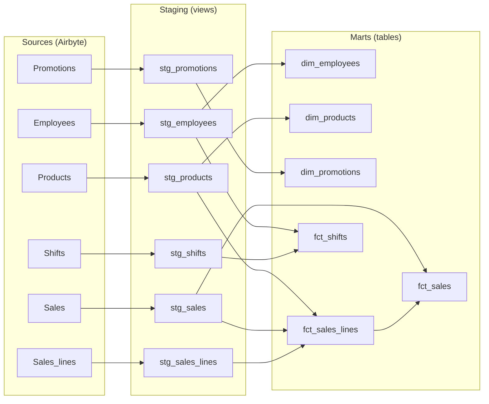

# stroopwafelshop-data-platform

End-to-end analytics platform for a fictional stroopwafel shop: **Airbyte → BigQuery → dbt → Tableau**.
A portfolio project based on the book *Fundamentals of Analytics Engineering*.

The shop's operational data (sales, products, promotions, employees and shifts) lives in Google Sheets.
This project loads it into BigQuery and models it into a tested star schema that answers questions
like *which products and promotions drive revenue and margin?* and *what does labour cost per day?*

## Architecture

```
Google Sheets ──Airbyte──▶ BigQuery (raw) ──dbt──▶ BigQuery (staging → marts) ──▶ Tableau
                           stroopwafelshopdata      <dataset>_staging / _marts
```

The project follows the **ELT** pattern: Airbyte only extracts and loads, all transformation happens
in the warehouse with dbt. The raw data stays untouched, so every model can be rebuilt from source.

| Layer | Tool | Status |
|---|---|---|
| Extract & load | Airbyte (Google Sheets → BigQuery) | ✅ |
| Transform & test | dbt Core 1.12 on BigQuery | ✅ |
| Visualise | Tableau | planned |

## dbt project

The dbt project lives in [`stroopwafelshop/`](stroopwafelshop/) and has three layers.



### Sources
All six Airbyte tables are declared in
[`_stroopwafelshop__sources.yml`](stroopwafelshop/models/staging/stroopwafelshop/_stroopwafelshop__sources.yml).
Models reference them with `source()` and not hard-coded table names, so lineage starts at the raw
tables, and `_airbyte_extracted_at` is set as the loaded-at field for freshness checks.

### Staging (views)
One model per source table, doing only light cleaning:

- **rename** to consistent names (`id` → `employee_id`, `date` → `sale_date`), so a key has the same name everywhere
- **cast** the Google Sheets strings to proper types: `DATE`, `TIME`, `INT64`, `BOOL`, and `NUMERIC` for money (exact, unlike `FLOAT64`)
- **drop** the `_airbyte_*` metadata columns
- **parse** `Shifts.hours` (`"10:00-14:00"`) into start time, end time and duration, with a `shift_id` surrogate key on employee + date + start time

No joins or business logic happen here. Staging is cheap and should always reflect the current raw data, so views are enough.

### Marts (tables)
A Kimball star schema, materialised as tables because BI tools query them repeatedly.

| Model | Grain (one row =) | Contents |
|---|---|---|
| `fct_sales_lines` | one product within one sale | quantity, gross / discount / net amount, cost, margin; sale attributes denormalised |
| `fct_sales` | one till transaction | totals rolled up from the lines, `has_promotion`, `is_empty_sale` |
| `fct_shifts` | one shift of one employee | duration and `labor_cost` (hours × hourly rate) |
| `dim_products` | one product | price, cost, unit margin |
| `dim_employees` | one employee | name, hire date, hourly rate |
| `dim_promotions` | one promotion | product, period, discount rate, holiday flag |

The two sales facts serve different questions: product and promotion analysis needs line grain,
while basket size and transaction counts need sale grain. `dim_employees` is shared by the sales and
shift facts, so revenue and labour can be combined.

## Design decisions

- **Two sales facts at different grains.** Counting rows in `fct_sales_lines` would count lines, not customers. Each sale's total was verified to equal the sum of its lines, so both facts reconcile.
- **Empty sales are kept and flagged.** 130 sales (of 15,499) have no lines. All are €0.00 and spread evenly over the period, so they look like voided till transactions. `fct_sales` keeps them with `is_empty_sale = true`, and a warning-level test reports them on every run.
- **Personal data stops at staging.** `dim_employees` deliberately excludes date of birth and contact number: no analysis needs them (data minimisation).
- **No intermediate layer.** The joins are simple and the data is small; layers are added when they solve a problem, not by default.
- **`payment_type` as a degenerate dimension.** Three values and nothing else to describe, so it lives in the facts without a separate table.

## Data quality

65 tests run with every `dbt build`. A failing test stops the models downstream of it.

| Test | Checks |
|---|---|
| `unique` + `not_null` | every primary key |
| `relationships` | every foreign key exists in its parent (facts → dims, and within staging) |
| `accepted_values` | payment types, shift roles, weekdays |
| `dbt_utils.accepted_range` | quantity ≥ 1, shift duration > 0 |
| `dbt_utils.unique_combination_of_columns` | the natural key behind `shift_id` |
| `assert_sales_have_lines` (warn) | flags sales without lines |

Staging tests catch problems in the source early; mart tests protect what the reports use.
The empty-sales test is set to `warn`, not `error`: it is a known, explained data property, not a pipeline failure.

## Known limitations

- **No price or wage history.** Cost, margin and labour cost use the *current* product cost and hourly rate, because the source keeps no history. A dbt snapshot (SCD Type 2) would fix this.
- **Full rebuilds.** The data is small (~26k sales lines), so every model is rebuilt on each run. At larger volumes `fct_sales_lines` would become an incremental model.

## Roadmap

- [ ] `dim_date` calendar dimension
- [ ] Snapshots for product prices and hourly rates
- [ ] Seed with Dutch public holidays
- [ ] `dbt source freshness` on the Airbyte load
- [ ] Tableau dashboards, declared as dbt exposures
- [ ] CI: run `dbt build` on every pull request with GitHub Actions

## How to run

Requires Python 3.11 and access to a BigQuery project with the raw Airbyte tables.

```bash
python -m venv .venv
.venv\Scripts\activate          # Windows; use `source .venv/bin/activate` on macOS/Linux
pip install -r requirements.txt

cd stroopwafelshop
dbt deps                        # installs dbt_utils
dbt debug                       # checks the BigQuery connection
dbt build                       # builds all models and runs all tests
```

dbt reads the connection from a `stroopwafelshop` profile in `~/.dbt/profiles.yml` (BigQuery,
service-account authentication). Credentials and `profiles.yml` are never committed: see [`.gitignore`](.gitignore).

## Repository structure

```
stroopwafelshop/
├── models/
│   ├── staging/stroopwafelshop/   6 staging models + sources and tests (YAML)
│   └── marts/                     3 facts + 3 dimensions + tests (YAML)
├── tests/                         singular tests
├── dbt_project.yml                materialisations and schemas per layer
└── packages.yml                   dbt_utils
```
